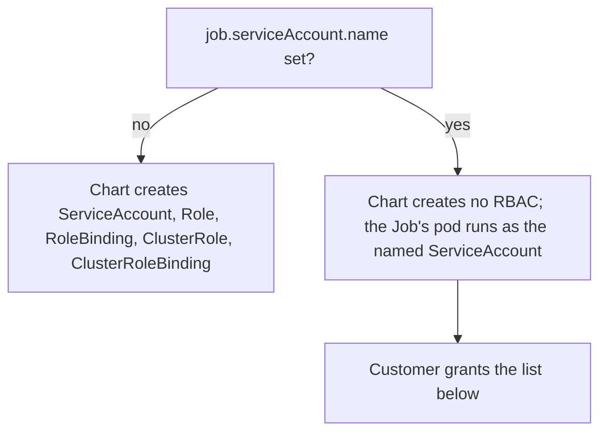

# Deployment — On-demand collection

This file is the technical reference for the `router-diagnostics-chart` chart — deployment tiers, RBAC, and cluster footprint. For the step-by-step customer-facing setup flow, see `specs/user_experience.md`.

The tool deploys on-demand (flare-style) support bundle collection for Kubernetes deployments only.

## Deployment tiers

| Deployment tier | Customer supplies | How the tool locates the router |
| --- | --- | --- |
| **Official Apollo router Helm chart** | `namespace` | Standard chart label `app.kubernetes.io/name=router`. ConfigMap name, config key, and ports are fixed by the chart |
| **Raw manifests / custom deployment** | `namespace`, `selector`, `configMapName` | Entirely from customer-supplied values — no convention applies |

## Collection modes

Every non-Operator deployment runs collection in one of two modes, set via the chart's `mode` value.

- **`mode: local`** — you run the collection yourself, with your own kubectl access. See [`mode: local`](#mode-local).
- **`mode: job`** — a Kubernetes Job runs the collection in-cluster, for teams whose kubectl access to production is restricted and who need a platform team to run it on their behalf. See [`mode: job`](#mode-job).

## troubleshoot.sh support-bundle version

Apollo pins the troubleshoot.sh `support-bundle` version customers run, in both modes. `mode: local`'s collect script installs its own pinned binary (see [Prerequisite: download the router-diagnostics collect script](#prerequisite-download-the-router-diagnostics-collect-script)). `mode: job`'s Job image bundles its own (see [The Job image](#the-job-image)). Both pins are kept in lock-step with the chart's own declared `troubleshoot_version` (`specs/collection/meta_json.md`) by a single Renovate custom manager (`.github/renovate.json5`). A version bump always arrives as one PR touching all four files (`collect.sh`, `collect.ps1`, the Job image Dockerfile, and the chart's base spec ConfigMap template), treated as a deliberate, reviewed change per CLAUDE.md, not a routine dependency bump.

---

## Helm chart

Non-Operator customers install a single Helm chart, `router-diagnostics-chart`, with a required `mode` value. Rather than building separate mechanisms for the two modes, one chart serves both: `mode: local` renders only the spec, as a cluster ConfigMap and `mode: job` renders the same spec ConfigMap plus a Job and its ServiceAccount/RBAC to run the collection in-cluster.

Both modes render the spec as a ConfigMap labeled for `--load-cluster-specs` to discover. Who runs it, where, and how the bundle is retrieved differ, see [`mode: local`](#mode-local) and [`mode: job`](#mode-job) below.

```
router-diagnostics-chart/
├── templates/
│   ├── base-spec-configmap.yaml  # always rendered
│   ├── job.yaml                  # rendered only if mode: job
│   └── job-rbac.yaml             # rendered only if mode: job
└── values.yaml
```

```yaml
# templates/base-spec-configmap.yaml — always rendered
apiVersion: v1
kind: ConfigMap
metadata:
  name: router-diagnostics-spec
  labels:
    troubleshoot.sh/kind: support-bundle
data:
  support-bundle-spec: |
    {{ include "router-diagnostics.spec" . }}
  redactor-spec: |
    {{ include "router-diagnostics.redactors" . }}
```

### Chart values common to both modes

| Value | Required | Default | Applies to | Purpose |
| --- | --- | --- | --- | --- |
| `namespace` | Yes | — | Official chart, raw manifest / custom | The router's namespace. Rendered into every collector that accepts it, including `clusterResources.namespaces` as a single-element list. Never rely on the kubectl context fallback. |
| `mode` | Yes | — | Official chart, raw manifest / custom | `local` or `job` |
| `selector` | Raw-manifest tier only | The official chart's `app.kubernetes.io/name=router` label | Raw manifests / custom | Pod label selector, e.g. `app=my-router`. Also selects which pods `router-metrics` scrapes and is resolved each time collection runs. Set it on the official chart too if the router's `app.kubernetes.io/name` label isn't `router` (for example, with `router.nameOverride` or an aliased install). See `specs/collection/base_spec.md` → Per-pod metrics collection |
| `configMapName` | Raw-manifest tier only | Label-based targeting, no name needed | Raw manifests / custom | Name of the ConfigMap holding the router config |
| `metricsPort` | No | `9090` | Official chart, raw manifest / custom | Port the router's metrics endpoint is reachable on, if not `9090`. |
| `logs.maxAge` | No | Unset — no age cap | Official chart, raw manifest / custom | Maps to the `logs` collector's `limits.maxAge`. How far back to reach, e.g. `2h` |
| `logs.maxLines` | No | `10000` (troubleshoot.sh default) | Official chart, raw manifest / custom | Maps to `limits.maxLines`. Lines from newest per container |

`mode`-specific values (`job.podAnnotations`, `job.podLabels`) are documented in [`mode: job`](#mode-job) below.

## `mode: local`

You run the collection yourself, with your own kubectl access.

If the router's metrics are missing because collection runs outside a service mesh (the bundle says no pod responded), see [Running outside the mesh doesn't have to mean losing metrics](#running-outside-the-mesh-doesnt-have-to-mean-losing-metrics).

### Prerequisite: download the router-diagnostics collect script

Collection for `mode: local` runs through a standalone script. Download it once, then keep it
in your working directory.

**macOS / Linux** (requires `kubectl` and `curl`):

```bash
curl -sSLo collect.sh https://router.apollo.dev/router-diagnostics-collect/latest
chmod +x collect.sh
```

**Windows** (requires `kubectl`; run in PowerShell):

```powershell
Invoke-WebRequest -Uri https://router.apollo.dev/router-diagnostics-collect-ps1/latest -OutFile collect.ps1
```

Both scripts **cache a pinned `support-bundle` binary locally** (in `~/.router-diagnostics/bin`
on Unix, `%USERPROFILE%\.router-diagnostics\bin` on Windows, or the path in
`ROUTER_DIAGNOSTICS_CACHE_DIR`), keyed by version so a pin bump downloads a fresh binary rather
than reusing a stale one — **Apollo controls this version** — then run it non-interactively
(`--interactive=false`), see [Permissions for `mode: local`](#permissions-for-mode-local) for
why, against the cluster's discoverable specs.

**Reaching the router's metrics port is handled by the spec itself** The
router's metrics port is only reachable through in-cluster pod IPs, which don't resolve from the
invoking user's own machine. Rather than `collect.sh` bridging this, the chart renders a
`hostCollectors.run` script — a troubleshoot.sh collector type that just executes whatever script
the spec hands it — directly into the spec ConfigMap at `helm install` time, using the
`selector`/`metricsPort` values given there (see `specs/collection/base_spec.md` → Per-pod
metrics collection). That script runs as part of collection itself, every time `collect.sh`
invokes `support-bundle --load-cluster-specs --namespace <namespace>`:

   - Resolving every pod matching `selector` (defaulting to the official chart's own
     `app.kubernetes.io/name=router` label) via `kubectl get pods`, at collection time.
   - For each matched pod, starting `kubectl port-forward pod/<pod-name> <metricsPort>:<metricsPort>`
     (default `9090:9090`), scraping `/metrics`, then tearing the forward down before moving to
     the next pod.
   - Writing each pod's scrape into the bundle. See `specs/collection/output.md` →
     `router-metrics` layout for exactly where that lands.

   If the script can't list pods, no pod matches `selector`, or a matched pod doesn't respond, the script writes a plain
   explanation into the bundle instead of leaving the section silently empty (see
   `specs/collection/base_spec.md` → Per-pod metrics collection for each case). `nodeMetrics` is the only source of container-level memory/CPU figures regardless, since the router's Prometheus endpoint does not serve them (see `specs/collection/base_spec.md` → footnote \[2\]).

   `mode: job` runs the same script, resolving pods the same way at collection time, but inside
   the Job's pod. That pod is already inside the cluster network, so the script requests each
   matched pod's IP directly and skips the port-forward; this per-pod bridging is a `mode: local`
   concern only.

### Invocation for `mode: local`

**Official Apollo Helm chart:**

```bash
helm install router-diagnostics oci://registry-1.docker.io/apollograph/router-diagnostics-chart \
  --namespace <namespace> \
  --set namespace=<router_namespace> \
  --set mode=local

./collect.sh --namespace <namespace>
```

**Raw-manifest / custom deployment:**

```bash
helm install router-diagnostics oci://registry-1.docker.io/apollograph/router-diagnostics-chart \
  --namespace <namespace> \
  --set namespace=<router_namespace> \
  --set selector="app=my-router" \
  --set configMapName=my-config \
  --set mode=local

./collect.sh --namespace <namespace>
```

`selector`/`configMapName` only need to be set at `helm install` time above — they're rendered into
the spec ConfigMap once and the collect script has no need to see them again.

On Windows, replace `./collect.sh --namespace <namespace>` with:

```powershell
.\collect.ps1 -Namespace <namespace>
```

`--namespace` (Unix) / `-Namespace` (Windows) is a plain, required argument to the collect
script. It must match wherever you actually installed the chart: both the `helm install
--namespace` and the chart's own `--set namespace=<router_namespace>` value above. The script
passes it directly to `support-bundle --load-cluster-specs --namespace`, which is what discovers
the rendered spec ConfigMap.

### Permissions for `mode: local`

Requires permission to create a ConfigMap in the target namespace, plus `create` on the `pods/portforward` subresource in the router's namespace to reach `router-metrics`. Declining the latter does not fail collection. The script includes the port-forward's error in each pod's "no response" line. Running the collection uses the invoking user's existing kubectl credentials.

Collection never needs root: `collect.sh` runs `support-bundle` with `--interactive=false`, so the CLI's default sudo-reexec prompt (triggered by the presence of any `hostCollectors.run` entry, not an actual root requirement) never appears.

### Cluster footprint for `mode: local`

Spec ConfigMap + Helm release metadata. Once installed, subsequent collections are just `./collect.sh --namespace <namespace>` again, with no reinstall. Customers who want nothing left behind can `helm uninstall` after collecting.

---

## `mode: job`

For teams whose kubectl access to production is restricted and who need a platform team to run collection on their behalf.

### The Job image

The troubleshoot `support-bundle`binary ships in the Job's container image.

The image also needs `aws-cli` and `gcloud` bundled alongside the support-bundle binary. The generated support bundle is uploaded by invoking these CLIs directly, see `specs/storage/object_storage.md`.

The image also bundles `kubectl` and `curl`, which the `router-metrics` script uses to list router pods and scrape each one when collection runs (`specs/collection/base_spec.md` → Per-pod metrics collection).

### Chart values specific to `mode: job`

| Value | Required | Default | Purpose |
| --- | --- | --- | --- |
| `job.podAnnotations` | No | `{sidecar.istio.io/inject: "false", linkerd.io/inject: disabled}` | Annotations merged onto the Job's pod template, customer values win over the defaults — see [Service mesh environments](#service-mesh-environments) below |
| `job.podLabels` | No | `{}` | Arbitrary labels merged onto the Job's pod template |
| `job.ttlSecondsAfterFinished` | No | `3600` | Maps to the Job's `ttlSecondsAfterFinished` — how long after completion Kubernetes automatically deletes the Job and its pod object. See [Cluster footprint for `mode: job`](#cluster-footprint-for-mode-job) below for what this window is actually for. |
| `job.serviceAccount.name` | No | When unset the chart creates `router-diagnostics-job` | Name of an existing ServiceAccount in the release namespace for the Job's pod to run as. When set, the chart creates no ServiceAccount, Role, RoleBinding, ClusterRole or ClusterRoleBinding, and the customer provides the grants in [Running under your own ServiceAccount](#running-under-your-own-serviceaccount). |
| `job.serviceAccount.annotations` | No | `{}` | Annotations merged onto the ServiceAccount the chart creates (IRSA or Workload Identity, see `specs/storage/object_storage.md` → Credentials). Setting it together with `job.serviceAccount.name` fails the render because the chart doesn't create that ServiceAccount and the annotations would have no effect |

```yaml
# templates/job.yaml — only rendered if mode: job
{{- if eq .Values.mode "job" }}
apiVersion: batch/v1
kind: Job
...
{{- end }}
```

### Invocation for `mode: job`

A platform team member with cluster access installs the chart with `mode=job` (plus `selector`/`configMapName` if the deployment is raw-manifest). The Job runs the collection using its namespace-scoped ServiceAccount and the platform team retrieves the bundle. Like `collect.sh`, the Job runs `support-bundle` with `--interactive=false`, since the spec carries a `hostCollectors.run` entry (see [Permissions for `mode: local`](#permissions-for-mode-local) for why).

Nothing the chart renders depends on the live cluster, so `mode: job` behaves the same whether the chart is installed with `helm install` or rendered with `helm template` and applied by a GitOps tool such as ArgoCD. See `specs/storage` for details on retrieving the bundle.

### Service mesh environments

**Injecting a sidecar risks the Job never completing.** A Job's pod is expected to terminate when its work finishes and Kubernetes only marks a Job `Complete` once every container in its pod has exited. An injected mesh proxy (e.g. `istio-proxy`) is a long-running sidecar that keeps waiting for traffic after the collection container is done, so the pod sits in `Running` indefinitely instead of reaching `Completed`. That leaves a stuck workload in the customer's production namespace and no clean signal that collection succeeded.

Given that, the chart sets `job.podAnnotations` to disable injection by default, but only for two meshes: Istio and Linkerd. This is a best-effort default, not a claim to cover every mesh, and it is a starting point the customer can override.

- **A different mesh** — the customer adds their mesh's own opt-out annotation via `job.podAnnotations`. Helm merges customer-supplied keys over the chart's defaults, so this is additive.
- **Policy requires every pod to stay in the mesh** — the customer overrides the specific default key back, e.g.:

  ```yaml
  job:
    podAnnotations:
      sidecar.istio.io/inject: "true"
  ```

  This is the customer's call, not our chart's. It's only safe from the stuck-`Completed` risk on a Kubernetes-native sidecar (`restartPolicy: Always`, GA in Kubernetes 1.29+, supported by recent Istio/Linkerd).

- `meta.json`'s `sidecar_injection_disabled` field records whether the chart disabled injection (`specs/collection/meta_json.md` → Render-time facts), ruling out one cause of an empty metrics section — but disambiguating a mesh-blocked scrape from a misconfigured exporter still needs the collected `router.yaml` (see `specs/collection/base_spec.md` → Service mesh and proxy environments).

- Disabling injection still leaves the Prometheus scrape itself blocked by a mesh enforcing strict mTLS — see [Running outside the mesh doesn't have to mean losing metrics](#running-outside-the-mesh-doesnt-have-to-mean-losing-metrics) for how to recover it.

### Permissions for `mode: job`

Additionally requires creating a Job and, unless `job.serviceAccount.name` is set, a namespace-scoped ServiceAccount, a Role/RoleBinding, and a ClusterRole/ClusterRoleBinding (for `nodeMetrics`'s cluster-scoped grants). By default, running the collection uses **a namespace-scoped ServiceAccount created by the chart**, run on the customer's behalf by a platform team member via the Job. With `job.serviceAccount.name` set, the chart creates none of these RBAC objects and the platform team provides the grants instead, see [Running under your own ServiceAccount](#running-under-your-own-serviceaccount). Its Role's `get`/`list` on pods is also what `router-metrics` uses to find router pods at collection time; unlike `mode: local`, no `pods/portforward` grant is needed.

#### `nodeMetrics` RBAC

`nodeMetrics` needs three separate grants to reach `/api/v1/nodes/<node>/proxy/stats/summary`:

- **`nodes` (list)** — to resolve node names when neither `nodeNames` nor `selector` is set.
- **`nodes/proxy` (get)** — required unconditionally by the API server for any request matching the `/nodes/{name}/proxy/{path}` URL pattern. This is a broad grant: Kubernetes' own RBAC good-practices documentation states it "provides access to privileged kubelet APIs that can retrieve container logs or execute and attach to pod processes... bypasses audit logging and admission control," and is explicitly "not a read-only permission." What this tool does with it is read-only, but the grant itself authorizes more than that one use, and it cannot be scoped to just the router's nodes.
- **`nodes/stats` (get)** — required separately by the kubelet's own authorization check, layered on top of `nodes/proxy`, not a substitute for it.

Declining only `nodes/proxy`/`nodes/stats` (possible when you manage the RBAC yourself) still leaves `nodes` access (node pressure conditions) and everything `clusterResources` provides — OOM kill occurrences and last state, restart counts, configured limits. What's lost is container memory and CPU usage, and the router's own Prometheus endpoint serves jemalloc memory gauges but no container RSS, working-set or CPU figures, so it is not a substitute. See `specs/collection/base_spec.md` → footnote \[2\].

The chart currently only supports declining all three grants together via `job.collectNodeMetrics: false` at install time. This skips creating the ClusterRole/ClusterRoleBinding entirely and the `nodeMetrics` collector itself then comes back empty rather than the install failing. Node pressure conditions then come back empty too since the `nodes` list grant is part of that ClusterRole.

See `specs/collection/base_spec.md` for the rest of the permission set the collectors need.

#### Running under your own ServiceAccount

Creating cluster-scoped RBAC is a large permission to ask of whoever installs the chart, and a platform team may prefer to own the permissions itself. Setting `job.serviceAccount.name` moves that responsibility to the customer:



- The Job's pod runs as the named ServiceAccount, which must already exist in the release namespace. The projected token with `expirationSeconds: 600` is unchanged.
- With `job.collectNodeMetrics: false`, node metrics are declined whatever the named ServiceAccount is granted, so the cluster-scoped grants below are not needed.

The ServiceAccount needs the following. The namespaced rules are those of the Role the chart otherwise creates, bound in the router's namespace (the `namespace` value). The cluster-scoped rules are those of the ClusterRole the chart otherwise creates:

```yaml
# Namespaced: a Role in the router's namespace, bound to the ServiceAccount
rules:
  - apiGroups: [""]
    resources:
      - configmaps
      - endpoints
      - events
      - limitranges
      - persistentvolumeclaims
      - pods
      - pods/log
      - resourcequotas
      - serviceaccounts
      - services
    verbs: ["get", "list"]
  - apiGroups: ["apps"]
    resources: ["daemonsets", "deployments", "replicasets", "statefulsets"]
    verbs: ["get", "list"]
  - apiGroups: ["batch"]
    resources: ["cronjobs", "jobs"]
    verbs: ["get", "list"]
  - apiGroups: ["rbac.authorization.k8s.io"]
    resources: ["rolebindings", "roles"]
    verbs: ["get", "list"]
  - apiGroups: ["policy"]
    resources: ["poddisruptionbudgets"]
    verbs: ["get", "list"]
  - apiGroups: ["networking.k8s.io"]
    resources: ["ingresses", "networkpolicies"]
    verbs: ["get", "list"]
  - apiGroups: ["discovery.k8s.io"]
    resources: ["endpointslices"]
    verbs: ["get", "list"]
  - apiGroups: ["coordination.k8s.io"]
    resources: ["leases"]
    verbs: ["get", "list"]
---
# Cluster-scoped: a ClusterRole, bound to the ServiceAccount with a ClusterRoleBinding.
# Omit it when job.collectNodeMetrics is false.
rules:
  - apiGroups: [""]
    resources: ["nodes"]
    verbs: ["list"]
  - apiGroups: [""]
    resources: ["nodes/proxy", "nodes/stats"]
    verbs: ["get"]
```

A grant the ServiceAccount lacks is reported in the bundle the same as it is under the chart-created ServiceAccount.

### Cluster footprint for `mode: job`

Spec ConfigMap + Helm release metadata + ServiceAccount/Role/RoleBinding (just the spec ConfigMap and the Job when `job.serviceAccount.name` is set). The Job itself is transient: it sets `ttlSecondsAfterFinished: 3600` (see `job.ttlSecondsAfterFinished` above), so Kubernetes automatically deletes the Job and its pod an hour after it completes — nothing to clean up by hand. Customers who want nothing left behind entirely (including the spec ConfigMap and RBAC) can `helm uninstall` after collecting.

Each collection gets its own Job, named `router-diagnostics-job-{{ .Release.Revision }}`. The Job carries `helm.sh/resource-policy: keep` so that Helm doesn't prune the previous revision's Job the moment a new one supersedes it in the rendered manifest.

That same annotation also stops `helm uninstall` from deleting the Job early. The accepted edge case this creates: `helm uninstall` followed immediately by a fresh `helm install` into the same namespace restarts `.Release.Revision` at 1, so if the prior install's `router-diagnostics-job-1` hasn't hit its TTL yet, the new install's own `router-diagnostics-job-1` collides with it and fails to create. This is documented for customers in `docs/getting-started/job-mode.mdx` → "Cleaning up," with the workaround.

---

## Running outside the mesh doesn't have to mean losing metrics

This applies to both modes — neither `mode: local` (the customer's own machine) nor an un-injected `mode: job` Job pod is inside the mesh. `logs`, `clusterResources`, `nodeMetrics`, `configMap` all reach their data through the Kubernetes API server or the kubelet, which the mesh does not sit in front of, so running outside it doesn't affect them. The Prometheus scrape is the one collector that talks directly to a router port, and a mesh enforcing strict mTLS will reject it from a pod outside the mesh, so the metrics port needs an explicit exception.

The fix is on the router's side: the customer exempts its metrics port from mTLS — Istio's `PeerAuthentication: PERMISSIVE` scoped to that port (or `traffic.sidecar.istio.io/excludeInboundPorts`), Linkerd's `config.linkerd.io/skip-inbound-ports`. This is platform-team guidance to apply once, not a chart setting.

If a platform team won't grant that then retrieving metrics will not be possible. The only in-mesh alternative is an `exec`-based scrape from inside the router's own pod and `exec` collectors are deliberately excluded from the base spec.
