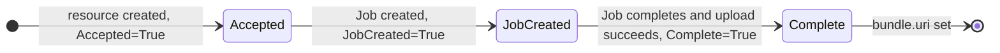
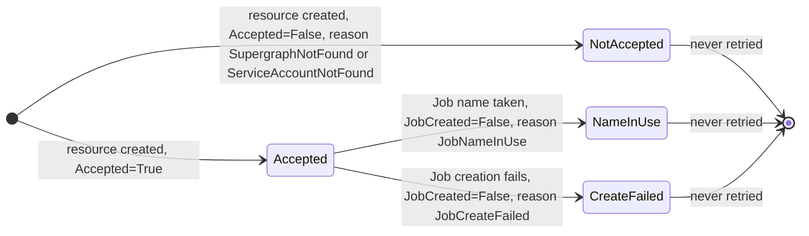
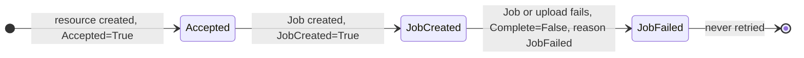

# Deployment — Apollo Operator

This document specifies how a customer running routers through the [Apollo GraphOS Operator](https://github.com/apollographql/operator) requests an on-demand collection of a support bundle ([`specs/trigger/flare.md`](../trigger/flare.md)). Collection runs as it does in `mode: job` ([`specs/deployment/on-demand-collection.md`](on-demand-collection.md)), the same Job image collects the base spec ([`specs/collection/base_spec.md`](../collection/base_spec.md)) and the bundle lands in customer-provided object storage ([`specs/storage/object_storage.md`](../storage/object_storage.md)). This file only includes details that are specific to Operator-managed routers.

## The `RouterDiagnostics` resource

We introduce the `RouterDiagnostics` custom resource as the mechanism for triggering a single support bundle collection. The resource's `spec`, shown below, describes the collection and is immutable after creation. To change anything, or to trigger another support bundle collection, create a new `RouterDiagnostics` resource.

```yaml
apiVersion: apollographql.com/v1alpha1
kind: RouterDiagnostics
metadata:
  name: investigate-latency
  namespace: apollo
spec:
  supergraphRef:
    name: my-supergraph          # a Supergraph in this namespace
  serviceAccountName: router-diagnostics
  storage:
    provider: s3
    bucket: my-router-diagnostics
    prefix: router-bundles/
    s3:
      region: us-east-1
    existingSecret: ""
  collectNodeMetrics: true
  logs:
    maxAge: 2h
    maxLines: 10000
  ttlSecondsAfterFinished: 3600
  job:
    podAnnotations: {}
    podLabels: {}
```

| Field | Required | Default | Purpose |
| --- | --- | --- | --- |
| `supergraphRef.name` | Yes | — | The `metadata.name` of the `Supergraph` resource to collect. The Operator looks it up in the `RouterDiagnostics` resource's own namespace, so the `Supergraph` must be in that namespace. |
| `serviceAccountName` | Yes | — | The ServiceAccount the Job's pod runs as. It must already exist in the `RouterDiagnostics` resource's namespace and be granted the permissions in [Permissions](#permissions). |
| `storage` | Yes | — | Same as in job mode, see `job.storage` (`specs/storage/object_storage.md`). A `RouterDiagnostics` resource with no `storage` is rejected. |
| `collectNodeMetrics` | No | `true` | Same meaning as `router-diagnostics-chart`'s `job.collectNodeMetrics` (`specs/deployment/on-demand-collection.md` → Kubelet stats RBAC). `false` declines the node-scoped reads. |
| `logs.maxAge`, `logs.maxLines` | No | Same defaults as `router-diagnostics-chart`'s `logs.*` | Same meaning as those chart values. See `specs/deployment/on-demand-collection.md` → Chart values common to both modes. |
| `ttlSecondsAfterFinished` | No | `3600` (Same default as `router-diagnostics-chart`) | Maps to the Job's `ttlSecondsAfterFinished` with the same meaning as `router-diagnostics-chart`'s `job.ttlSecondsAfterFinished`. |
| `job.podAnnotations`, `job.podLabels` | No | Same defaults as `router-diagnostics-chart`'s `job.*` | Same meaning and the same service-mesh defaults as those chart values (`specs/deployment/on-demand-collection.md` → Service mesh environments). |

## Collecting a support bundle

Creating a `RouterDiagnostics` resource triggers one support bundle collection. The Operator does not re-collect when the router, the `Supergraph` or the Operator restarts, or if the Job is later deleted.

1. The customer sets up the ServiceAccount and storage credentials beforehand (see [Permissions](#permissions)). The user who requests the collection needs `create` on `RouterDiagnostics` in the router's namespace.

2. The user applies a `RouterDiagnostics` manifest. The manifest specifies the `Supergraph` to collect the support bundle from, the ServiceAccount the Job runs as, and where to upload the bundle.

   ```bash
   kubectl apply -f router-diagnostics.yaml
   ```

3. When the Operator first sees the resource, it creates a Job in the router's namespace configured for that `Supergraph`. Each Job is named `router-diagnostics-<name>` where `<name>` is the `RouterDiagnostics` resource's `metadata.name`. The CRD limits that name to 44 characters so the Job name always fits. The Operator passes the Job the values the base spec needs as environment variables (see [How the Job is configured](#how-the-job-is-configured)).

4. The Job runs the `mode: job` image with a few additions (see [Changes to the Job image](#job-image)). The Job's command renders `router-diagnostics-chart` to produce the SupportBundle spec. It then collects the spec, redacts it, and uploads the bundle (the same as in job mode).

5. The Operator reports the outcome on the `RouterDiagnostics` resource's `status`, which includes where the bundle landed.

### Cleanup

The Job is owned by the `RouterDiagnostics` resource. As with job mode, the Job and its pod are deleted `ttlSecondsAfterFinished` after completion. The resource itself is a record of the collection and is not deleted by the Operator. Deleting te `RouterDiagnostics` resource deletes its Job.

## How the Job is configured

The Operator works out the values the base spec needs, the same ones a customer sets when installing `router-diagnostics-chart` (see [`specs/deployment/on-demand-collection.md`](on-demand-collection.md) → Chart values common to both modes). It reads them from the `RouterDiagnostics` resource and the `Supergraph` resource the `RouterDiagnostics` spec names and passes them to the Job as environment variables.

| `router-diagnostics-chart` value | Value for an Operator-managed router |
| --- | --- |
| `namespace` | The namespace of the `RouterDiagnostics` resource (this namespace must be the same one the `Supergraph` named in `supergraphRef.name` is in). |
| `selector` | `apollographql.com/supergraph=<supergraphRef.name>`. This matches what the Operator labels the router's pods and ConfigMaps with. |
| `metricsPort` | The `Supergraph`'s `spec.networking.metricsPort`. When it is unset the router's Prometheus exporter is disabled and the value is omitted |
| `logs.*` | From the `RouterDiagnostics` spec |

## Job image

The Operator runs job mode's image, `router-diagnostics-job-image`, with three additions so the Job can render the chart itself when it starts. The Operator sets the script as the Job's `command`.

- the `helm` binary
- a copy of `router-diagnostics-chart`
- a script that renders the chart with the values the Operator passes, then collects and uploads the bundle as job mode does.

Because the Job renders the spec from `router-diagnostics-chart`, the chart stays the single source of truth for the base spec and its redactors.

The Job's image is set in the Operator's Helm values:

```yaml
config:
  controllers:
    routerDiagnostics:
      jobImage: "docker.io/apollograph/router-diagnostics:<version>"
```

## Permissions

The Job runs as the ServiceAccount the user sets in `spec.serviceAccountName`. The Operator does not create that ServiceAccount or any Role or ClusterRole for it. Kubernetes only lets you create a Role that grants permissions you already have yourself. To give the Job read access to pod logs and node stats, the Operator would therefore need that access itself, access it has no other use for. Instead, the user creates the ServiceAccount and grants it the permissions it needs. See [`specs/deployment/on-demand-collection.md`](on-demand-collection.md) → Running under your own ServiceAccount.

## Monitoring the Job

The Operator reports progress on the `RouterDiagnostics` resource's `status`.

| Field | Meaning |
| --- | --- |
| `jobName` | The Job the Operator created |
| `startTime`, `completionTime` | Job start time and completion time |
| `bundle.uri` | Where the bundle was uploaded (for example `s3://my-router-diagnostics/router-bundles/support-bundle-<timestamp>.tar.gz`). Set only when `Complete` is `True` |
| `conditions` | `Accepted`, `JobCreated` and `Complete`. Each has a `status`, a `reason` and a `message`. See the table below for more details. |

The Job can be monitored by reading the conditions outlined below:

| Condition | `True` means | `False` means |
| --- | --- | --- |
| `Accepted` | The `Supergraph` and the ServiceAccount both exist. | The `Supergraph` (reason `SupergraphNotFound`) or the ServiceAccount (reason `ServiceAccountNotFound`) does not exist. No Job is created. |
| `JobCreated` | The Operator created the Job. | Another Job already has the name the Operator would use (reason `JobNameInUse`), or creating it failed for another reason, such as the API server being unavailable (reason `JobCreateFailed`, with the error in the `message`). See [No Job is created](#no-job-is-created). |
| `Complete` | The Job completed and the upload exited successfully as defined by `specs/storage/object_storage.md`. | The Job or its upload failed (reason `JobFailed`). The `message` carries the failure reason from the Job's pod. |

- A collection is finished when `Complete` is `True` or when `Accepted`, `JobCreated` or `Complete` is `False`.

- The Operator never retries a `RouterDiagnostics` resource, including one where creating the Job failed.

### Successful support bundle collection



### No Job is created

No Job is created when the resource is not accepted, when another Job already has the name `router-diagnostics-<name>`, or when creating the Job fails for another reason, such as the API server being unavailable.



### The Job runs and fails to collect a support bundle



## What differs in the bundle

Below we outline the differences in the `meta.json` file found in a support bundle generated by Operator-managed router has.

- `meta.json` records `mode: operator` as the mode.

- `meta.json` has a `supergraph` field whose value is the the name of the `Supergraph` collected. This fields will only be present in bundles collected with the Operator.

- `meta.json` also contains a `metrics_enabled` field indicating whether the `Supergraph` configures a metrics port. This fields will only be present in bundles collected with the Operator.
